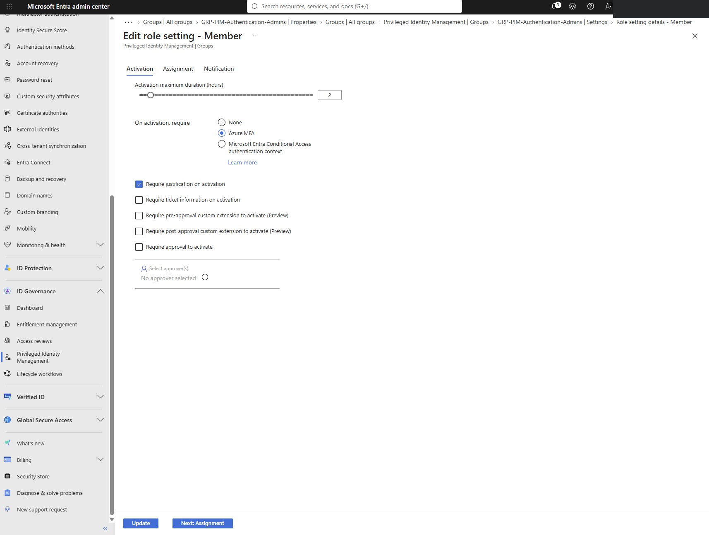
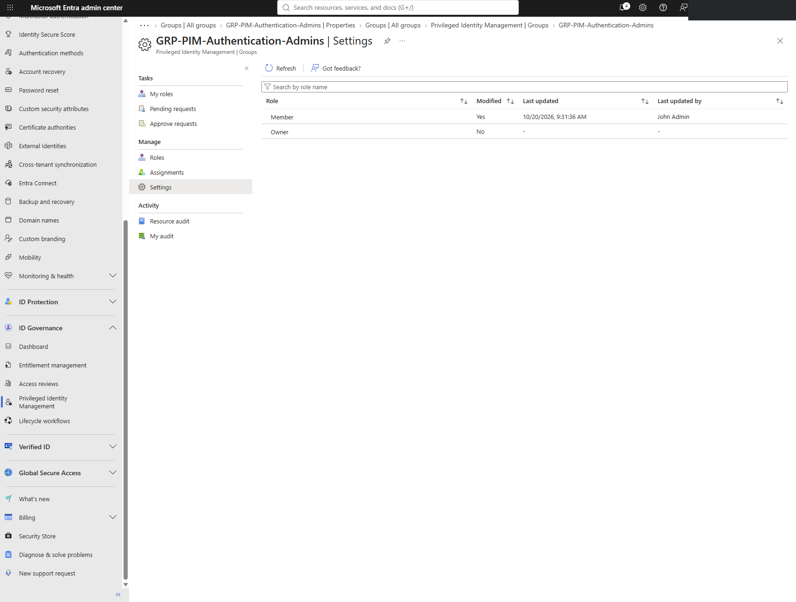
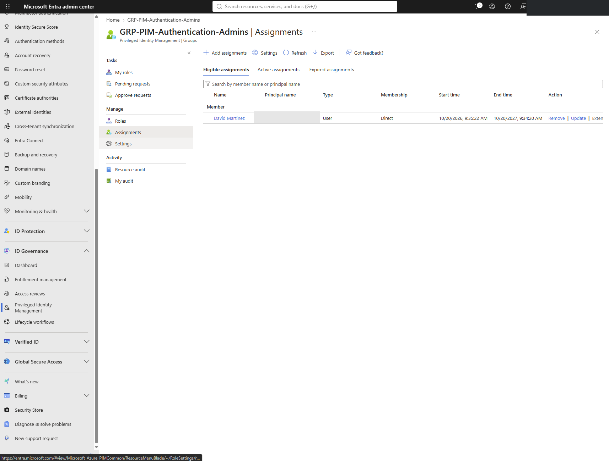
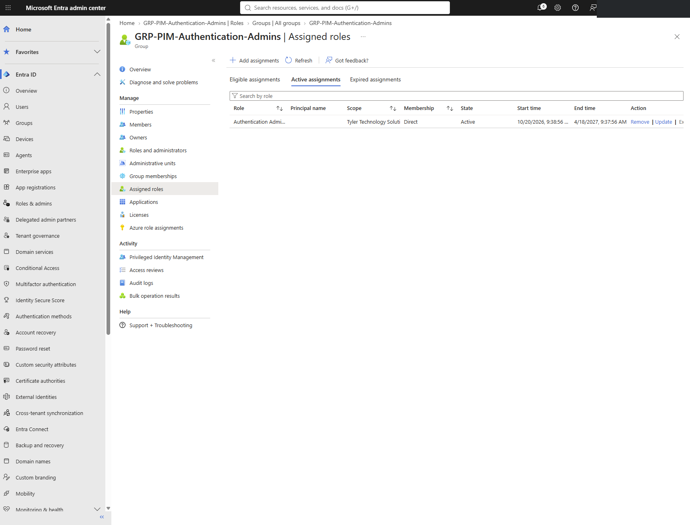
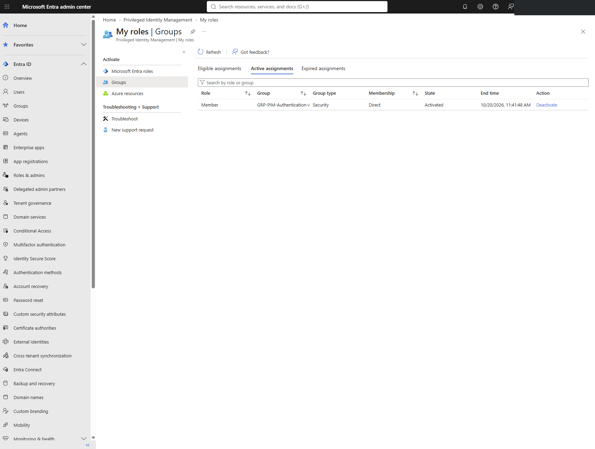
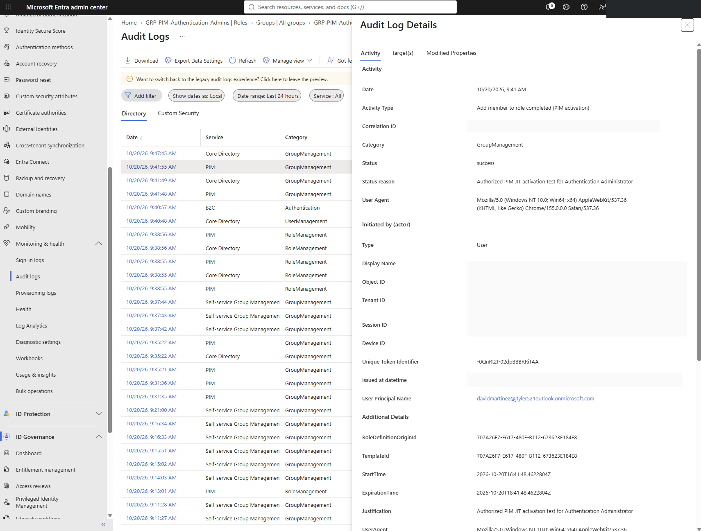
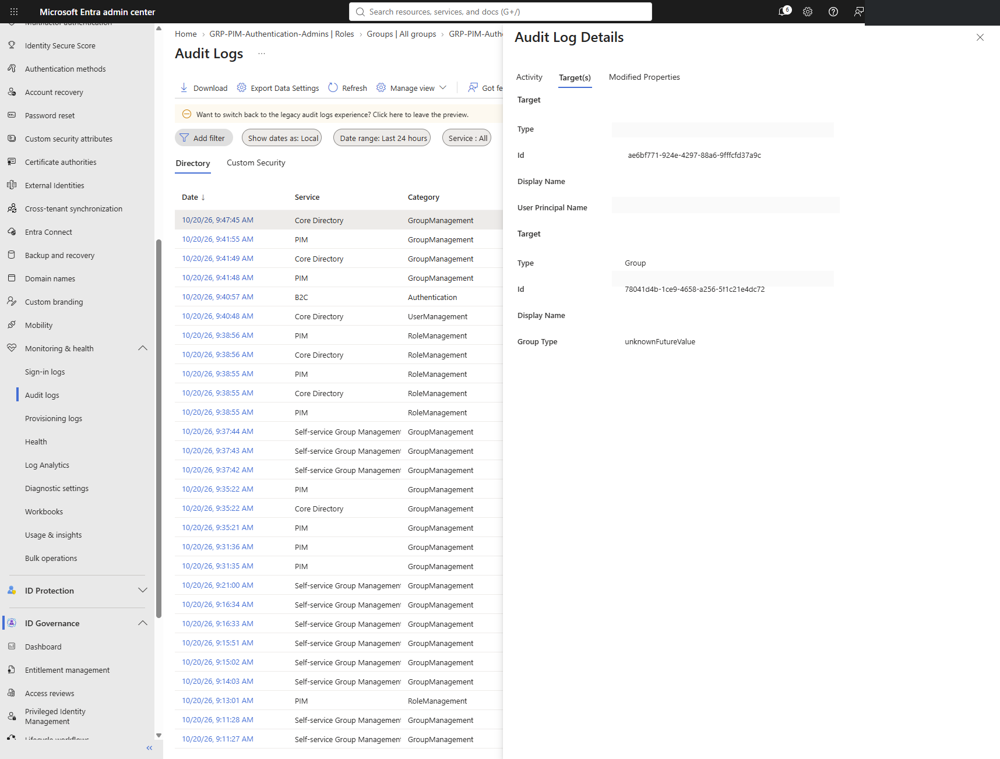
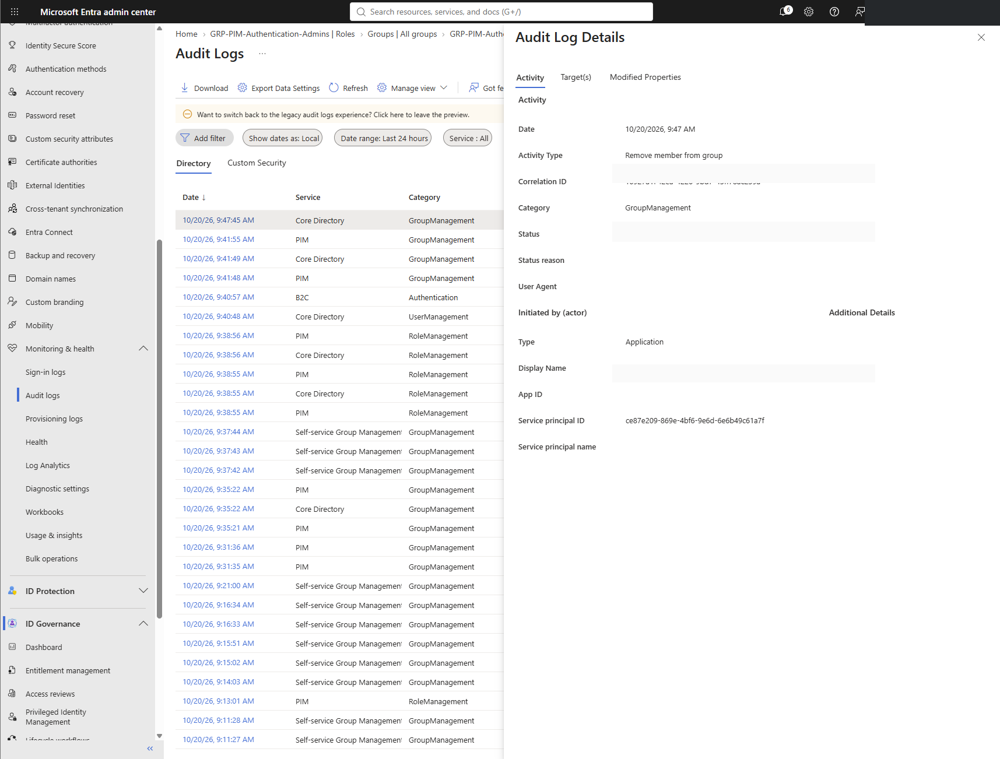

# Microsoft Entra PIM — Group-Based Just-in-Time Access Lifecycle Lab

**Platform:** Microsoft Entra ID / Privileged Identity Management (PIM) for Groups  
**Focus:** Identity governance, privileged role assignment, eligible group membership, time-bound activation, and audit evidence  
**Environment:** Microsoft Entra lab tenant  
**Validation date:** October 20, 2026

## Overview

Implemented a role-assignable Microsoft Entra security group managed by **PIM for Groups**, assigned the **Authentication Administrator** directory role to the group, and configured an authorized test identity (David Martinez) as an **eligible group member**. Tested temporary membership activation and reviewed successful activation and group-membership removal audit events.

The solution separates the standing directory role assignment to a privileged group from **time-limited human membership** in that group, providing an auditable just-in-time access workflow.

## Architecture

```text
David Martinez (eligible member; no standing group membership)
                  |
                  v
         PIM for Groups activation
         • Azure MFA required
         • Justification required
         • Maximum duration: 2 hours
                  |
                  v
      GRP-PIM-Authentication-Admins
         (temporary active member)
                  |
                  v
         Authentication Administrator
      (active directory role assigned to group)
                  |
                  v
          Microsoft Entra audit logs
```

## Implementation

1. Created `GRP-PIM-Authentication-Admins`, a role-assignable security group with assigned membership type.
2. Verified `IsAssignableToRole = True` using Microsoft Graph PowerShell.
3. Configured the PIM **Member** activation policy: two-hour maximum activation, Azure MFA, and required justification. Approval and ticket fields were not required for this single-admin lab.
4. Assigned David Martinez as an **eligible Member**, rather than a permanently active member. The eligibility period is distinct from each activation's duration.
5. Verified an **active**, time-bounded Authentication Administrator role assignment to the group at directory scope (shown ending April 18, 2027).
6. Signed in as David Martinez and successfully activated group membership.
7. Inspected the successful PIM activation audit event and recorded justification.
8. Confirmed a subsequent successful `Remove member from group` event initiated by `MS-PIM`, with David and the privileged group as targets.

## Screenshot evidence

Upload the **redacted** screenshots into the `screenshots/` directory with these exact filenames:

| Step | Evidence | Screenshot |
|---|---|---|
| 1 | Member activation settings: MFA, justification, two-hour maximum |  |
| 2 | Saved member policy |  |
| 3 | David's eligible group membership |  |
| 4 | Active Authentication Administrator assignment to group |  |
| 5 | David's activated PIM group membership |  |
| 6 | Successful activation audit event |  |
| 7 | User and group identified as removal audit targets |  |
| 8 | Successful MS-PIM membership removal audit event |  |

> Evidence images are uploaded separately by the repository owner. Until the files are present in `screenshots/`, their image links will not render.

## Verification results

| Check | Result |
|---|---|
| Role-assignable group, via Microsoft Graph | **Verified:** `IsAssignableToRole=True` |
| Eligible PIM membership | **Verified** |
| Active directory role assignment to group | **Verified** |
| PIM membership activation | **Verified** |
| Activation audit event | **Verified** |
| MS-PIM membership removal audit event | **Verified** |
| Fresh-session check proving absence of effective administrative permissions after removal | **Not yet captured** |

**Important distinction:** A successful removal audit event demonstrates a group-membership removal operation. It does not, on its own, prove that previously issued access tokens immediately lost all effective authorization. Validate revocation in a fresh session using a harmless permission check and allow for propagation/token lifetime.

## Security design notes

- Use a separate low-privilege test account; direct administrative roles can mask the effect of PIM.
- Maintain independently protected emergency-access accounts outside the routine activation path.
- Review and renew time-bounded role assignments before they expire.
- Consider authentication contexts with phishing-resistant authentication strength for high-risk activation.
- In production, consider independent approvers, role separation, monitoring, and documented break-glass procedures.
- Audit group ownership, membership changes, role assignments, and activation policies.

## Verification command (read-only)

```powershell
Connect-MgGraph -Scopes "Group.Read.All"
Get-MgGroup -GroupId "<GROUP_OBJECT_ID>" -Property "DisplayName,IsAssignableToRole" |
    Select-Object DisplayName, IsAssignableToRole
```

Replace `<GROUP_OBJECT_ID>` with your group object ID. Do not publish unredacted identifiers, correlation IDs, session identifiers, or live authentication artifacts.

## Skills demonstrated

**Microsoft Entra ID · Privileged Identity Management · PIM for Groups · Identity Governance · RBAC · Just-in-Time (JIT) Access · MFA · Privileged Access Auditing**
